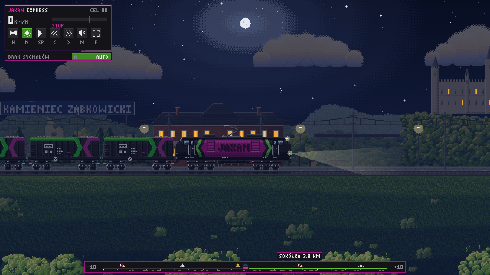

# JAXAN Express

Pikselowa, zapętlona scena kolejowa na ekran w biurze: lokomotywa **Newag Dragon 2 w barwach JAXAN**
ciągnie węglarki **Eamos JAXAN** z kruszywem przez nieskończony krajobraz – złote łany pól, lasy,
polskie wsie (stodoły, koźlaki, bociany, kapliczki), mosty i zakłady – po pętli **Sokółka** (stacja + żwirownia) → **most na Wiśle i Warszawa**
(panorama z Pałacem Kultury, Varso, Złotą 44) → **Kamieniec Ząbkowicki** (kamieniołom + stacja) → Sokółka…
Przed każdą stacją stoją **semafory świetlne PKP**.

Vite + TypeScript + Canvas 2D, zero zależności w czasie działania. Grafika i dźwięk generowane w kodzie.



## Online

Wersja do obejrzenia w przeglądarce: **https://digital-knight1103.github.io/jaxan_lok/**
(publikowana automatycznie z `main` przez GitHub Actions). Ostatnia aktualizacja: 15.11.2026.

> JAXAN, Dragon 2 (Newag) i Eamos to znaki i nazwy ich właścicieli. Projekt jest fanowski
> i niekomercyjny, nie jest powiązany z żadnym z nich ani przez nich popierany.

## Uruchomienie

```bash
npm install
npm run dev      # http://localhost:5173
npm run build    # wersja produkcyjna w dist/ (wystarczy dowolny serwer plików)
npm run test     # testy logiki (vitest)
```

Na ekranie biurowym: otwórz stronę w Chrome/Firefoksie i naciśnij **F** (pełny ekran).
Na monitorze 1920×1080 obraz to dokładnie 640×360 pikseli gry × 3 – ostro, bez pasów.
W innych rozdzielczościach używana jest największa całkowita skala, a resztę wypełniają ciemne pasy.

## Sterowanie

| Akcja | Klawisz | Mysz / dotyk |
| --- | --- | --- |
| Trąbienie (przytrzymaj = dłużej) | `H` | klik w lokomotywę lub przycisk 📯 |
| Noc / dzień (przejście ~3 s) | `N` | przycisk księżyc/słońce |
| Start / stop | `Spacja` | przycisk ▶/⏸ |
| Prędkość −/+ 10 km/h (0–120) | `←` / `→` | przyciski « » lub klik w pasek prędkości |
| Dźwięk wł./wył. | `M` | przycisk głośnika |
| Pełny ekran | `F` | przycisk ⛶ |
| Jazda AUTO / RĘCZNA | `A` | klik w pole AUTO/RĘCZNA pod panelem |
| Skok do poprzedniego / następnego punktu trasy | `[` / `]` | klik w ikonę na mapie trasy |
| Przewijanie podglądu mapy | – | przeciągnij pasek mapy myszą lub palcem |
| Pogoda: AUTO → pogodnie → pochmurno → deszcz → mgła → śnieg → AUTO (napis z nazwą na ekranie) | `W` | przycisk pogody rozwija menu z ikonami |
| Tryb kinowy (bez HUD i mapy, kamera) | `C` | przycisk 🎬 `C`; dowolny klawisz / ruch myszy = powrót |
| Lista skrótów (nakładka) | `?` | przycisk `?`; zamyka dowolny klawisz lub kliknięcie |

Przy każdym przycisku HUD widać literę skrótu (H, N, SPC = Spacja, <, >, M, F, W, C, ?). Przy pierwszym
uruchomieniu przez 8 s pokazuje się podpowiedź „? – sterowanie” (zapamiętana w `localStorage`).

- **Mapa trasy** (pasek na dole) pokazuje pociąg i punkty w promieniu ±10 km: stację Kamieniec
  Ząbkowicki 🏠, kopalnię ⛏, Sokółkę (żwirownia), Warszawę (PKiN) – pełne ikony – oraz mosty i zakłady (małe znaczniki – pełna ikona po najechaniu).
  Nad paskiem widać nazwę i odległość najbliższej stacji/kopalni (albo punktu pod kursorem).
  Kliknięcie punktu albo `[` / `]` = szybki przejazd: krajobraz mknie z rozmyciem i ściemnia się,
  potem pociąg dojeżdża i **zatrzymuje się** przy punkcie (Spacja – jazda dalej). Wciskając `]` kilka razy
  w trakcie przejazdu, przeskakuje się o kolejne punkty. Podgląd po przeciągnięciu wraca do pociągu po 5 s.
- **Semafory**: ok. 1 km przed stacją tarcza ostrzegawcza (pomarańczowe = semafor „stój”,
  zielone migające = „zwolnij do 40”, zielone = „droga wolna”), przed peronem semafor wjazdowy
  (zielone / pomarańczowe = 40 km/h / czerwone = stój). Sygnał losowany przy zbliżaniu się pociągu;
  czerwone po 5–15 s zmienia się na zielone lub pomarańczowe.
  - **AUTO** (domyślnie i po 3 min bez dotykania): pociąg sam zwalnia, staje przed czerwonym i rusza.
  - **RĘCZNA** (po użyciu Spacji, `←`/`→` lub paska prędkości; powrót do AUTO: `A` lub klik w pole trybu): pod panelem HUD podgląd najbliższego
    sygnału i odległość. Przejechanie czerwonego = alarm **RADIOSTOP**, hamowanie nagłe i komunikat
    „Przejechanie sygnału STÓJ!”.
  - Szybki przejazd z mapy omija semafory bez kar. Na mapie semafory to drobne znaczniki w kolorze sygnału.
- **Ograniczenia prędkości (wg Ie-1)**: prędkość szlakowa 120 km/h; co kilka km odcinki 100 / 80 /
  rzadziej 60 km/h długości 1–3 km, a przy każdej stacji 60 lub 80 km/h od semafora wjazdowego do końca stacji
  (deterministycznie z seeda). Wskaźniki: **W 8** (biały trójkąt wierzchołkiem w dół, czarna liczba =
  prędkość w dziesiątkach km/h, np. 8 = 80) stoi o drogę hamowania przed odcinkiem; **W 9** (biały
  prostokąt z czarnym kątem wierzchołkiem w dół) oznacza początek, jego odwrotna strona (kąt
  wierzchołkiem w górę) – koniec. Ograniczenie obowiązuje, dopóki koniec minie ostatni wagon.
  HUD (prawy górny róg): duże „obowiązuje”, pod nim „następne: 100 za 1,2 km”, obok aktualna prędkość.
  - **AUTO** jedzie 120 km/h, płynnie zwalnia przed W 9 i przyspiesza za końcem ograniczenia.
  - **RĘCZNA**: bez kar – przy przekroczeniu panel miga na pomarańczowo (widać go nawet przy ukrytym HUD).
  - Na mapie trasy ograniczenia to cienkie paski pod torem (jasny = 100, pomarańczowy = 80, czerwony = 60).
- **Pogoda** zmienia się sama co 3–10 min (pogodnie → pochmurno → deszcz → pogodnie, rzadko pochmurno →
  śnieg, rano czasem pogodnie → mgła), przejścia ~20 s. W trybie AUTO pogoda zmienia się sama; wybór ręczny
  (klawisz `W` albo menu pod przyciskiem pogody) trzyma wybraną pogodę, AUTO wraca do zmian. Mgła: warstwy
  gęstsze przy ziemi i w dolinach, dalsze plany prawie znikają, smugi dryfują; nocą reflektor lokomotywy
  rysuje we mgle wyraźny stożek światła; pociąg zostaje czytelny. Deszcz: skośne krople, mokre szyny, ciemniejsze niebo,
  cichy szum (po włączeniu dźwięku). Śnieg: płatki z paralaksą, biel na dachach, koronach i ziemi.
  Pogoda nie wpływa na fizykę jazdy. Tabor nie jest oprószany śniegiem (malowanie JAXAN bez zmian).
- **Tryb kinowy**: `C` albo 3 min bezczynności – chowa HUD i mapę, kamera powoli przybliża się (do ×1,3),
  oddala i przesuwa wzdłuż składu. Tylko w tym trybie wycinek bufora jest skalowany ułamkowo (bez
  wygładzania); zwykły widok zawsze ma skalę całkowitą.
- **Dźwięk jest domyślnie wyłączony** (biuro) – włącz go `M`. Trąbienie płoszy ptaki także bez dźwięku.
  Wszystkie poziomy głośności (silniki, stukot, klakson, pisk) są w `src/config.ts` → `AUDIO`.
- HUD chowa się po 4 s bezczynności, kursor po 3 s. Pierwszy dotyk tylko pokazuje HUD.
- Po **3 minutach bez dotykania** scena wraca do trybu „samograja”: jazda AUTO (120 km/h), tryb kinowy i automatyczny
  cykl dobowy (pełna doba = 8 minut).

## Styl grafiki (styl2)

Wzorzec: `reference/styl2.png`. Zasady obowiązujące w całej scenie:

- **Jedno źródło światła** – ciepłe słońce (albo księżyc) z jednej strony. Krawędź sylwetki od strony
  światła dostaje złoty **rim light**, przeciwna – chłodny, niebiesko-zielony cień. Nakładki liczone są
  raz na segment (`engine/light.ts`), co klatkę zmienia się tylko ich krycie.
- **5 tonów na materiał**: blask, światło, baza, półcień, cień (`segments/shade.ts`), przejścia
  ditherowane macierzą Bayera 4×4 (`engine/pixbuf.ts`).
- **Perspektywa powietrzna** – 6 planów zalesionych pasm z pojedynczymi koronami drzew
  (`scene/ridges.ts`), im dalej, tym bledsze i bardziej niebieskie.
- **Niebo** z ditherowanym gradientem i poświatą słońca/księżyca, chmury podświetlone od strony światła.
- Malowanie JAXAN (pasy, szewrony, X, logo) ma pierwszeństwo – brud, dithering i rim light nie zmieniają
  jego barw ani kształtów.

Krajobraz między lokalizacjami losowany jest z odcinków: pola w bruzdach i łany zboża, las, nasyp,
**wieś** (stodoła, wiatrak koźlak, gniazdo bociana, kapliczka, domy z dachówką, płoty, topole i wierzby
głowiaste – `sprites/village.ts`), most i zakład.

## Pory dnia

Pełna doba trwa 8 minut (w trybie „samograja”), `N` przełącza noc/dzień.

- **Złota godzina** rano i wieczorem – ciepłe, nisko padające światło i długi rim light,
- **południe** – chłodniejsze, jasne światło z góry,
- **noc** – księżycowa poświata, gwiazdy, okna i latarnie zapalone, reflektor lokomotywy.

Kierunek rim light podąża za słońcem lub księżycem (`DayCycle.golden`, `DayCycle.light` w
`scene/daycycle.ts`, z testami). Wzgórza i chmury mają po dwa warianty oświetlenia.

## Tabor

- **Newag Dragon 2 JAXAN** (`sprites/dragon2.ts`) – czarne pudło z magentowym pasem i zielonymi
  szewronami, pas połysku, cień pod okapem, odbicie nieba w szybach, wycieraczki, drzwi z klamkami,
  poręcze, bufory i sprzęgi, przewody, wózki ze sprężynami i maźnicami, pantograf.
- **Węglarka Eamos JAXAN** (`sprites/eamos.ts`) – czarne pudło z pasem i dużym X z grubych ramion
  (wg zdjęcia), ostojnica na wózkach Y25, koła na główce szyny, zderzaki na wysokości lokomotywy,
  sprzęgi i przewody między pojazdami, rdza tylko na czarnych polach. Na nierównościach toru
  podskakuje tylko pudło – wózki zostają na szynach.

Zrzuty wszystkich lokalizacji w dzień i w nocy: `screenshots/s2-*-dzien.png`, `screenshots/s2-*-noc.png`.

## Jak dodać nowy odcinek krajobrazu / nowe miejsce

1. Utwórz plik w `src/scene/segments/`, np. `lake.ts`, eksportujący obiekt `SegmentDef`
   (interfejs w `src/scene/segments/types.ts`):

   ```ts
   import type { SegmentDef } from './types';
   import { mulberry32 } from '../../engine/rng';
   import { drawBackStrip, drawGround } from './common';

   export const lake: SegmentDef = {
     id: 'lake',
     kind: 'filler',      // 'filler' = losowany odcinek, 'landmark' = punkt charakterystyczny
     width: 640,          // szerokość w pikselach gry
     weight: 2,           // jak często losowany (tylko filler)
     render({ back, bed, front }, seed) {
       const rnd = mulberry32(seed);
       // back – za torem, bed – pod torem, front – przed pociągiem; rysowane RAZ
       drawBackStrip(back, 0, 640, rnd);
       drawGround(bed, 0, 640, rnd);
     },
     // opcjonalnie: animate(ctx, x, env, seed) – ruch (dym, taśmy) co klatkę
     // opcjonalnie: animateBed(ctx, x, env, seed) – ruch pod torem (falujące zboże)
     // opcjonalnie: lights(ctx, x, env, seed) – światła w nocy (env.night 0..1)
     // opcjonalnie: signals: true – stacja z semaforami (tarcza 1 km przed + semafor wjazdowy)
     // opcjonalnie – pokaż na mapie trasy:
     // mapIcon: 'bridge' | 'plant' | 'station' | 'quarry' | 'gravel' | 'city', mapLabel: 'JEZIORO',
     // mapAnchor: 320   // px od początku segmentu, przy którym staje szybki przejazd (domyślnie środek)
   };
   ```

2. Dodaj go do `REGISTRY` w `src/scene/segments/registry.ts`.
3. Jeśli to **lokalizacja** (jak stacja czy kopalnia), ustaw `kind: 'landmark'` i dopisz ją do pętli
   `LANDMARK_ORDER` jako grupę, np. `{ ids: ['wisla', 'warszawa'] }` (segmenty jeden za drugim) albo
   `{ ids: ['quarry', 'station'], gapPx: 2400 }` (z odstępem). Lokalizacje pojawiają się po kolei, oddzielone
   co najmniej `LANDMARK_SPACING_PX` pól i lasów (`src/config.ts`; 22000 px ≈ 2,3 min przy 100 km/h).

Kolory dodawaj wyłącznie w `src/palette.ts`. Gotowe pomocniki: `drawGround`, `drawBackStrip`,
`scatterBushes`, `plantBackItem` (drzewa/choinki/krzaki) w `segments/common.ts`, `drawText` (pikselowa
czcionka z polskimi znakami) w `engine/font.ts`.

## Struktura

```
src/config.ts        stałe (wymiary, prędkości, czasy)
src/palette.ts       wszystkie kolory
src/main.ts          sklejenie modułów, kolejność rysowania warstw
src/engine/          ekran i skalowanie, pętla, wejście, audio, czcionka, sprite'y, pula cząsteczek;
                     light.ts – rim light, pixbuf.ts – bufor pikseli i dithering
src/scene/           niebo, pasma wzgórz (ridges.ts), chmury, tor, sieć trakcyjna, cykl dobowy, ptaki, iskry
src/scene/segments/  odcinki trasy: pola, las, nasyp, wieś, most, zakład; Sokółka, Wisła, Warszawa,
                     kamieniołom i stacja Kamieniec; stationkit.ts – wspólne elementy stacji,
                     shade.ts – cieniowanie 5 tonów
src/scene/signals.ts rysowanie semaforów i tarcz; limitsigns.ts – wskaźniki W 8/W 9
src/scene/weather.ts logika pogody, weatherfx.ts – deszcz, śnieg, mokre szyny; cinema.ts – kamera trybu kinowego
src/sprites/         lokomotywa Dragon 2, węglarka Eamos, koła, drzewa (nature.ts), wieś (village.ts)
src/train/           fizyka jazdy (z hamowaniem nagłym), skład, signals.ts – semafory, limits.ts – ograniczenia Ie-1
src/ui/hud.ts        panel sterowania
src/ui/routemap.ts   mapa trasy (pasek na dole)
src/scene/routeindex.ts  punkty trasy dla mapy (deterministyczny generator, ten sam seed)
src/scene/travel.ts  animacja szybkiego przejazdu do punktu
```

## Parametry diagnostyczne (adres strony)

- `?x=22820` – start w danym miejscu trasy (px), `?stop` – pociąg stoi,
- `?t=0.0` – pora doby (0 = północ, 0.5 = południe), wyłącza automat,
- `?w=rain` (`cloudy`, `snow`, `fog`, `clear`) – pogoda na starcie, `?cinema` – tryb kinowy od startu,
- `?soak=8` – test wytrzymałości: symulacja 8 godzin bez rysowania; wynik w konsoli
  (liczba segmentów/canvasów/iskier musi być stała).
